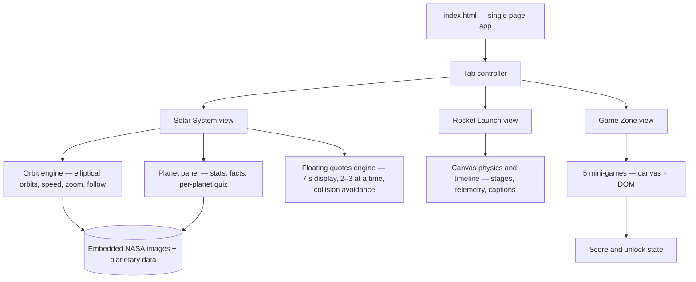

**🔴 Live Demo: [PASTE YOUR GITHUB PAGES URL HERE](https://YOUR-USERNAME.github.io/YOUR-REPO/)**

> NASA Space Apps Challenge, Nagpur 2026 · Wainganga College of Engineering & Management (WCEM) · AstraVeda 2026 × ICTRD

An interactive, kid-friendly web app that teaches the Solar System through a live orbit simulator, a rocket-launch simulation, and a set of educational mini-games. It runs entirely in the browser, with no installation, no login, and no build step.

---

## 1. Project Title & Problem Statement

**Challenge:** Build a Junior Astronaut Mission Trainer

**Problem summary:** The challenge is to build a **Junior Astronaut Mission Trainer** that lets young learners train like astronauts through fun, hands-on space missions.

**Our approach:** Space can feel distant and abstract for school students. We built a single, visual, hands-on learning experience that lets children aged 8–15 explore the planets, see how a rocket reaches orbit, and test what they have learned through quizzes and games, using real NASA imagery and real planetary data.

---

## 2. Team Details

| Field | Details |
|---|---|
| **Team Name** | Almighty hackoholics |
| **Local Event** | NASA Space Apps Challenge, Nagpur 2026 |

| # | Full Name | Institution | GitHub Username | Role |
|---|---|---|---|---|
| 1 | Avantika Nahak | S.B. Jain Institute of Technology,Management and Research | ofcavan | Team Lead and Project Manager |
| 2 | Uday Bahe | S.B. Jain Institute of Technology,Management and Research | uday_bahe7 | Lead Developer (Solar System) |
| 3 | Shobhit Meshram | S.B. Jain Institute of Technology,Management and Research | yng.shobhitto | Developer (Rocket Launch & Game Zone) |
| 4 | Ananaya Asole | S.B. Jain Institute of Technology,Management and Research | ani4ole | Content & Research Lead |
| 5 | Utkarsh Singade | S.B. Jain Institute of Technology,Management and Research | avior | UI/UX, Testing & Deployment |

---

## 3. Solution Overview & Architecture

### What it does

The app has three connected experiences, switched from the tab bar:

**🌞 Solar System**
- The Sun and all eight planets, shown with real NASA photographs, orbiting on elliptical paths.
- Click any planet to open its panel: description, key statistics, fun facts, and a short quiz.
- Controls for orbit speed, zoom (buttons and mouse wheel), pause, follow-planet, reset, and full screen.
- **Floating quotes and facts:** 2–3 space quotes, facts, and thoughts fade in and out around the screen. Each stays fully readable for 7 seconds, and they avoid overlapping planets and buttons.

**🚀 Rocket Launch**
- A canvas-based simulation of a two-stage rocket flight, from liftoff through max-Q, stage separation, orbit, and return to Earth.
- Live telemetry (time, altitude, speed), event captions that explain each stage in simple language, and 1x / 2x / 3x speed.
- Clearly labelled as an *educational simulation, not a live mission*.

**🎮 Game Zone**
Five missions that unlock in order and award points and stars:

| Mission | What the player does |
|---|---|
| Planet Explorer | Look at each planet and learn its name |
| Asteroid Challenge | Fly a ship, collect stars and crystals, dodge space rocks |
| Space Quiz | Answer questions about planets, moons, and stars |
| Find the Planet | Guess the planet from clues; fewer clues earn more points |
| Explore the Universe | Visit unlocked planets and discover facts |

### Key design choices
- **Child-friendly:** large readable text, glowing but calm visuals, friendly feedback in quizzes.
- **Zero-setup:** one self-contained `index.html` that works offline once loaded.
- **Responsive:** works on desktop, tablet, and phone.

### Architecture



### Technology stack

| Layer | Technology |
|---|---|
| Structure | HTML5 |
| Styling | CSS3 (variables, grid, flexbox, keyframe animations, backdrop-filter) |
| Logic | Vanilla JavaScript (ES6+), no frameworks or external libraries |
| Graphics | HTML5 Canvas (rocket simulation, games, starfield) and CSS-animated DOM bodies |
| Assets | NASA photographs embedded as Base64, so no external requests are needed |
| Hosting | GitHub Pages |

---

## 4. Live Demo 

- 🌐 **Hosted application:** `[https://YOUR-USERNAME.github.io/YOUR-REPO/]`

---

## 5. Installation & Setup Guide

There are no dependencies and no build step.

**Option A: Run locally (quickest)**

```bash
# 1. Clone the repository
git clone https://github.com/YOUR-USERNAME/YOUR-REPO.git

# 2. Enter the folder
cd YOUR-REPO

# 3. Open the app
#    Double-click index.html, or open it from the terminal:
start index.html        # Windows
open index.html         # macOS
xdg-open index.html     # Linux
```

**Option B: Serve with a local web server (optional)**

```bash
# Python 3
python -m http.server 8000
# then visit http://localhost:8000
```

**Option C: Deploy on GitHub Pages**
1. Push the project to a public repository, with the main file named `index.html`.
2. Go to **Settings → Pages**.
3. Under **Source**, choose the `main` branch and the `/ (root)` folder, then save.
4. After a minute, the site is live at `https://YOUR-USERNAME.github.io/YOUR-REPO/`.

**Browser support:** current Chrome, Edge, Firefox, and Safari.

### Data & image credits
Planet photographs are real NASA imagery from SDO, MESSENGER, Magellan, S-NPP VIIRS, Viking/Mars MDIM, Hubble, Cassini, Keck, and Voyager. Planetary facts such as orbit periods, sizes, and distances come from NASA's public planetary information. 

---

## 6. AI Usage Disclosure

In line with the event's AI policy, here is where and how AI tools were used.

| AI Tool | Where it was used | What it helped with |
|---|---|---|
| `Claude (Anthropic)` | `index.html` (floating quotes timing and display system) | Reviewing the existing code and rewriting its timing, spacing, and collision-avoidance logic |

**What our team did ourselves:** 
- Chose the concept: a Junior Astronaut Mission Trainer for children aged 8–15, and planned the three-part experience (Solar System, Rocket Launch, Game Zone).
- Designed the layout, learning flow, and mission-based game progression.
- Researched and wrote the planet descriptions, fun facts, quiz questions, and space quotes, and checked them against NASA sources.
- Collected and integrated real NASA photographs of the Sun and planets.
- Reviewed and tested the app on desktop and mobile, including the floating quote timing (7 seconds visible, 2–3 on screen at a time).
- Reported bugs, requested improvements, and verified every change before committing.
- Set up the GitHub repository, GitHub Pages hosting, README, and the demo video/slides.

**Commit authorship:** All commits were authored and pushed by registered human team members from their own GitHub accounts. No AI tool appears as a commit author or contributor.

---

## License & Acknowledgements

- NASA imagery is used under NASA's media usage guidelines. This is an educational project and is not affiliated with or endorsed by NASA.
- Built for the **NASA Space Apps Challenge, Nagpur 2026**, hosted by WCEM and co-organised by ICTRD under the AstraVeda initiative.
- Quotes are credited to their speakers inside the app.

*This is an educational simulation, not a live mission.*


